# 🗡️ Daggerheart: Store

Buying a sword in the middle of a session usually means opening a compendium, looking up the price and subtracting the coins from the character sheet by hand.

Daggerheart: Store opens a shop inside Foundry. The player picks an item and clicks Buy, and the price leaves the sheet and the item goes into the inventory. The GM decides what is on the shelves and what it costs, and can open the store for everyone or for a single player.

<p align="center">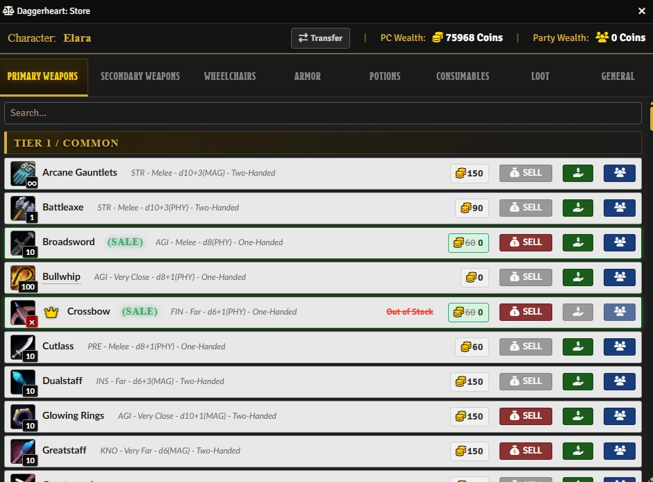</p>

[](https://buymeacoffee.com/mestredigital) [](https://mestredigital.online/pages/projetos-en)

## What players can do

* Browse the categories (Weapons, Armor, Potions and the others) in tabs, and search by typing part of an item's name. Clicking an item's image opens its compendium sheet.
* Buy an item. The cost is taken from the character sheet and the item is added to the inventory. Coin sounds and a styled chat message confirm the transaction.
* Split the cost of a purchase between the character and the Party Actor's funds, and see the party's wealth in the store header.
* Sell items from the character's inventory. Selling from a stack, such as three potions, sells one and keeps the rest. Items are listed under "Store Items" (priced by the catalog or by the GM) and "Other Items, Negotiation Only" (unpriced items, which can only be sold by proposing your own offer). The GM sets the sell value.
* Sell from the party's shared inventory in a second tab. It appears for players with Owner permission on the configured Party Actor, and the money goes to the party's wealth instead of the character's.
* Click the handshake button on an item to negotiate with the GM: propose an offer, receive counter-offers and accept when you agree. An accepted deal is blocked if it would leave your funds negative.
* See which items are on sale by their tag and reduced price.
* Read the main stats in the list: Damage, Range and Trait for weapons, Score and Thresholds for armor. A gold crown marks the weapons that match the character's highest Trait.
* Compare a store item with the one currently equipped before buying.
* Bookmark favorites and filter the list by them. They are kept between sessions.
* See the merchant's name and portrait. A tooltip shows the character's relationship with the merchant (Hostile, Distrustful, Neutral, Friendly or Allied).

With the **Update All** currency mode (the default), Handfuls, Bags and Chests on the player's sheet are converted into coins when the player opens the store.

## What the GM can do

* Open the store for all players or for one player.
* Save and load store profiles to switch between towns, merchants or campaign acts. Profiles can be updated and renamed. Epic item states and Randomizer options are saved per profile.
* Change prices with a global multiplier slider (50% to 300%), or override the price of any single item.
* Mark all items as On Sale or remove the sale, show or hide all items, enable or disable purchases and sales for all items, and reset every price to the default.
* Hide an item, or block its sale or purchase, one item at a time.
* Set a limited stock for an item. Stock is kept per profile, so several profiles can share the same Party Actor without mixing quantities.
* Mark an item as On Sale to apply the configured discount, or as Epic to give it a distinct visual effect (saved per profile).
* Choose which Tiers (1, 2, 3 and 4) appear in each category.
* Lock items so the Randomizer never replaces them, and use the Randomizer to generate the inventory of each category with the parameters you choose. A shortcut restores the maximum item counts.
* Turn player bargaining on or off in the Store Config. When a player negotiates, a window opens for the GM to counter, accept or reject the offer. The deal cannot be finalized if the player can no longer afford the price.
* Set the merchant's name, portrait and description in the Vendor tab, and set each player character's relationship level, from Hostile to Allied. Each level applies a price modifier after all other pricing rules.
* Edit an item's price, tier and header in the **Item Tagger**, which writes to the item's flags, so the description does not have to be edited by hand.
* Link a Party Actor to allow group purchases.
* Add homebrew compendiums to the store, or turn off the system's default compendiums to use only your own. A Custom Tab can be dedicated to one or more compendiums for special merchant inventories.
* Export the store configuration and all its profiles to a file from **Import / Export** in the module settings, and import it in another world or share it with other GMs. An import can replace the current settings, be merged with them, or bring in a single profile.

The currency name is read from the Daggerheart system settings.

## Setup and guide

The full guide covers linking player characters, opening the store, setting prices, profiles and homebrew content: [docs/WIKI.md](docs/WIKI.md).

Building a macro or a module that works with the store? See [docs/API.md](docs/API.md).

## Pricing rules

Loot and consumables are classified as Common, Uncommon, Rare and Legendary, which correspond to Tier 1, 2, 3 and 4. The prices follow the table on page 165 of the rulebook, and weapons and armor are priced from the same table.

## Screenshots

Selling from the character's own inventory. "Store Items" are priced by the GM and "Other Items" are available for negotiation only.

<p align="center">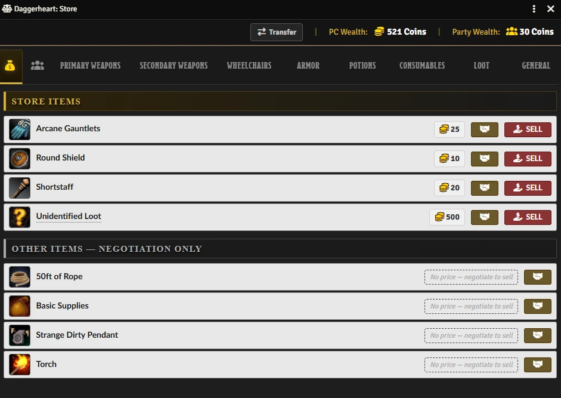</p>

Players with Owner permission on the Party Actor can sell from the shared Party Inventory tab.

<p align="center">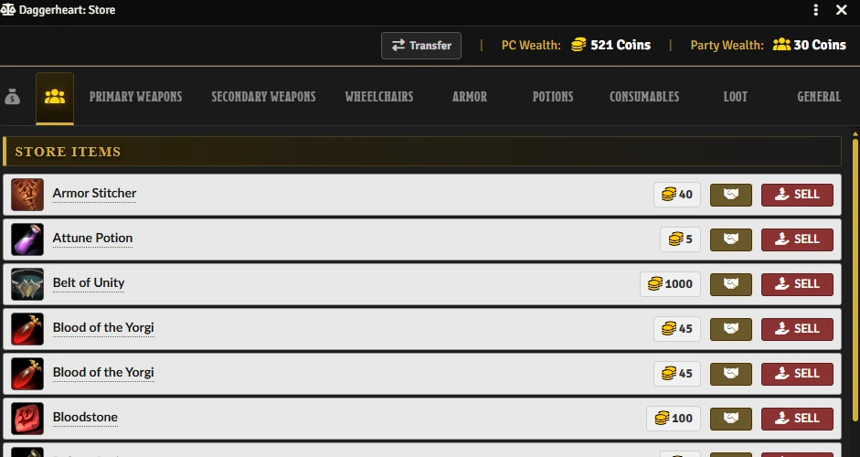</p>

<p align="center">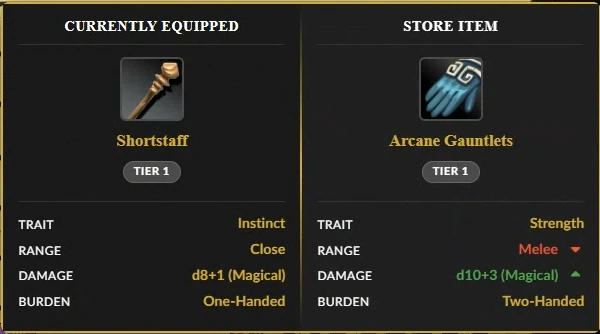</p>

A negotiation: the player proposes an offer, the GM counters, and they settle in real time.

<p align="center">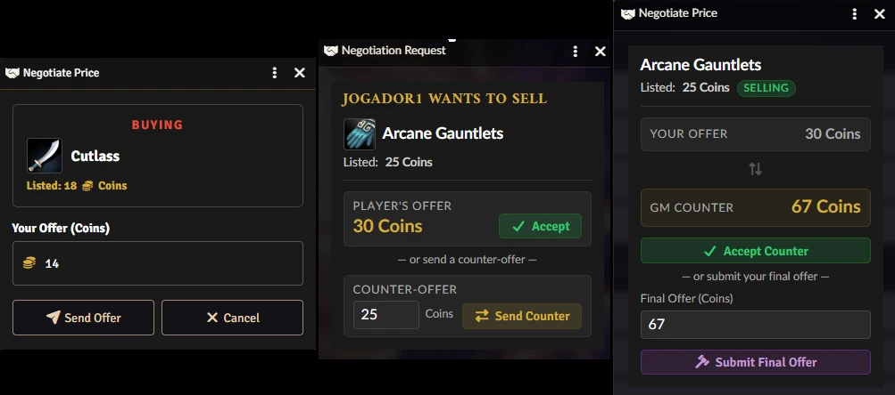</p>

The GM view has price controls, hide toggles, sale buttons and profile management.

<p align="center">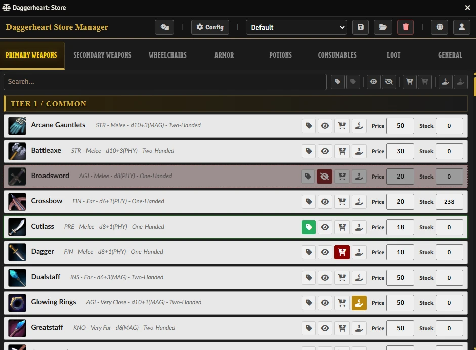</p>

<p align="center">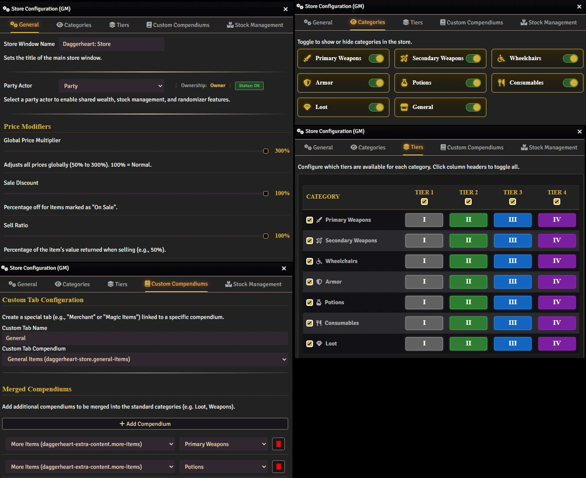</p>

<p align="center">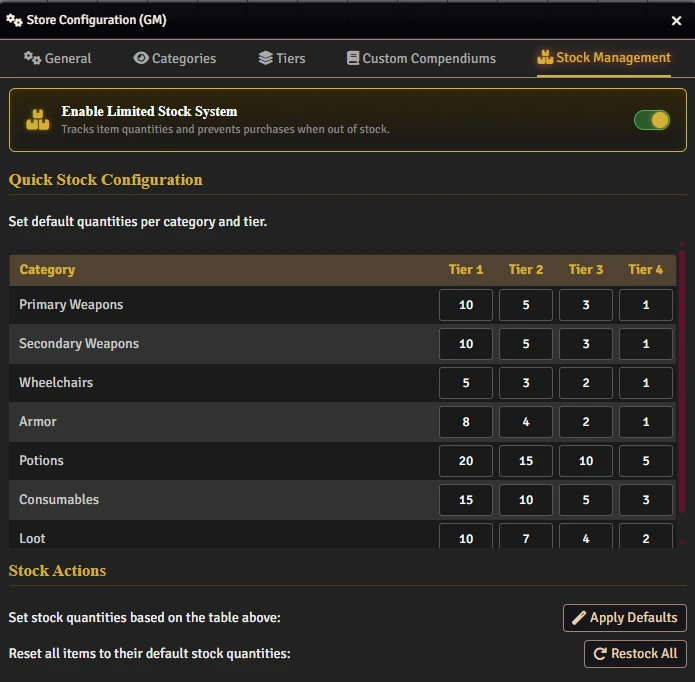</p>

<p align="center">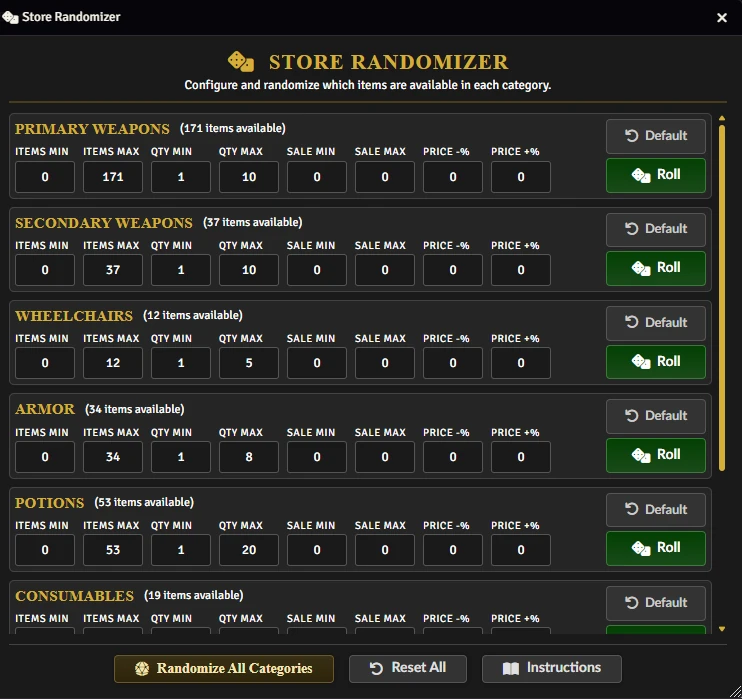</p>

Store profiles can be saved, loaded and managed from one window.

<p align="center">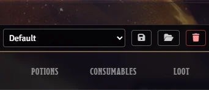</p>

Homebrew compendiums can be added to the store, or given a Custom Tab of their own.

<p align="center">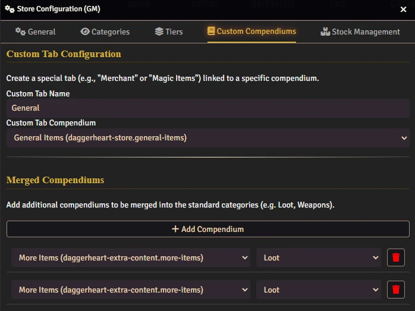</p>

## Installation

Install it from the Foundry VTT module browser, or use this manifest link:

```
https://github.com/brunocalado/daggerheart-store/releases/latest/download/module.json
```

It needs Foundry VTT 14 and the Daggerheart system 2.8.1 or newer, and was verified with Daggerheart 2.11.2.

## ⚖️ Credits and License

* **Code License:** GNU GPLv3.

* **epic.mp3 and coins.mp3** [Zapsplat](https://www.zapsplat.com). The audio assets are used in accordance with the Zapsplat Standard License.

**Disclaimer:** This module is an independent creation and is not affiliated with Darrington Press.

# 🧰 My Daggerheart Modules

| Module | Description |
| :--- | :--- |
| 💀 [**Adversary Manager**](https://github.com/brunocalado/daggerheart-advmanager) | Scale adversaries instantly and build balanced encounters. |
| 🖼️ [**Art Mapper**](https://github.com/brunocalado/dh-assets) | Automatically assigns artwork to system compendiums, actors, tokens, and custom module content — keeping your visuals organized and up to date. |
| 🐉 [**Colossus**](https://github.com/brunocalado/dh-colossus) | Manage massive multi-part boss encounters with independent HP per part and a single shared stress pool. |
| 💥 [**Critical**](https://github.com/brunocalado/daggerheart-critical) | Animated criticals. |
| 💠 [**Custom Stat Tracker**](https://github.com/brunocalado/dh-new-stat-tracker) | Add custom trackers to actors. |
| ☠️ [**Death Moves**](https://github.com/brunocalado/daggerheart-death-moves) | Enhances the Death Move moment with a dramatic interface and full automation. |
| 📏 [**Distances**](https://github.com/brunocalado/daggerheart-distances) | Visualizes combat ranges with customizable rings and hover calculations. |
| 📦 [**Extra Content**](https://github.com/brunocalado/daggerheart-extra-content) | Homebrew content pack. |
| 😱 [**Fear Tracker**](https://github.com/brunocalado/daggerheart-fear-tracker) | Adds an animated slider bar with configurable fear tokens to the UI. |
| 🧟 [**Horde**](https://github.com/brunocalado/dh-horde) | Explode single horde tokens into dozens of individual tokens and manage their movement and stats automatically. |
| 🎁 [**Mystery Box**](https://github.com/brunocalado/dh-mystery-box) | Introduces mystery box mechanics for random loot and surprises. |
| 📝 [**Nice Sheets**](https://github.com/brunocalado/dh-nice-sheets) | An alternative character sheet with a resource sidebar, ranked trait plaques, and the character's art filling the background. |
| ⚡ [**Quick Actions**](https://github.com/brunocalado/daggerheart-quickactions) | Quick access to common mechanics like Falling Damage, Downtime, etc. |
| 📜 [**Quick Rules**](https://github.com/brunocalado/daggerheart-quickrules) | Fast and accessible reference guide for the core rules. |
| 🤖 [**Resource Macros**](https://github.com/brunocalado/daggerheart-fear-macros) | Automatically executes macros when the Fear, Hope, Stress, HP, or Armor resources change. |
| 🎲 [**Stats**](https://github.com/brunocalado/daggerheart-stats) | Tracks dice rolls from GM and Players. |
| 🧠 [**Stats Toolbox**](https://github.com/brunocalado/dh-statblock-importer) | Import actors using a statblock. |
| 🛒 [**Store**](https://github.com/brunocalado/daggerheart-store) | A dynamic, interactive, and fully configurable in-game store. |
| 🔍 [**Unidentified**](https://github.com/brunocalado/dh-unidentified) | Obfuscates item names and descriptions until they are identified by the players. |
| 🌌 [**Void**](https://github.com/brunocalado/the-void-unofficial) | Unofficial module that brings The Void playtesting content — experimental classes, subclasses, ancestries, communities, adversaries, loot, weapons, and more. |

# 🗺️ Adventures

| Adventure | Description |
| :--- | :--- |
| ✨ [**I Wish**](https://github.com/brunocalado/i-wish-daggerheart-adventure) | A wealthy merchant is cursed; one final expedition may be the only hope. |
| 💣 [**Suicide Squad**](https://github.com/brunocalado/suicide-squad-daggerheart-adventure) | Criminals forced to serve a ruthless master in a land on the brink of war. |
