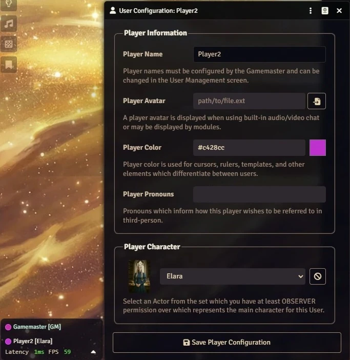
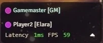
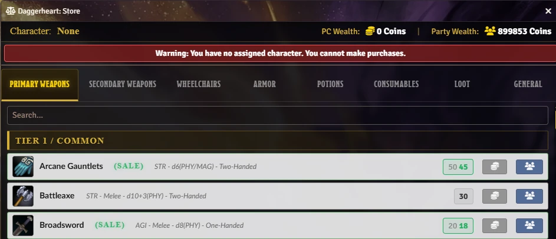
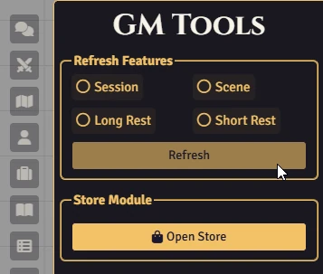
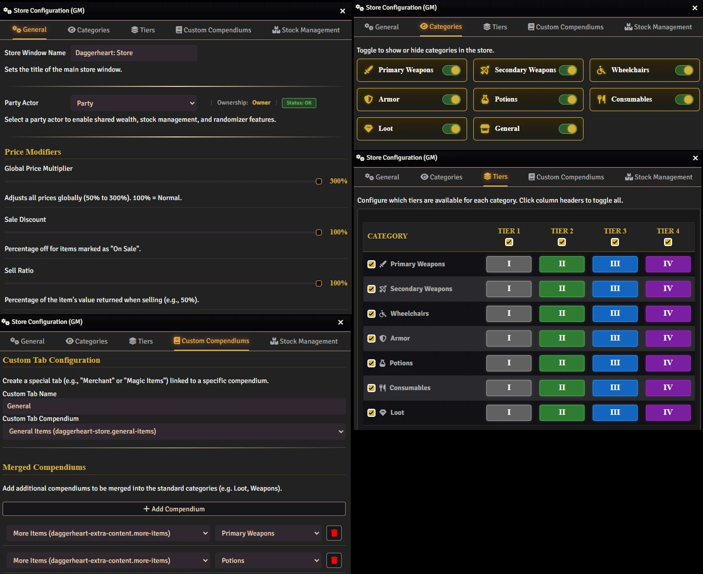
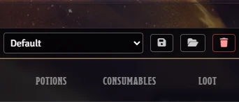
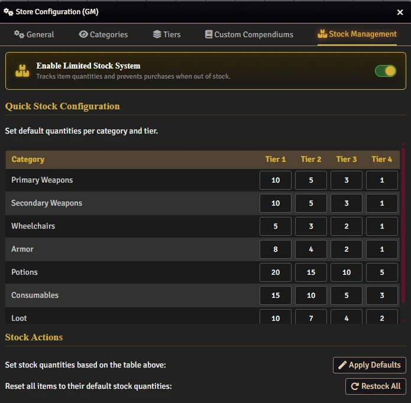
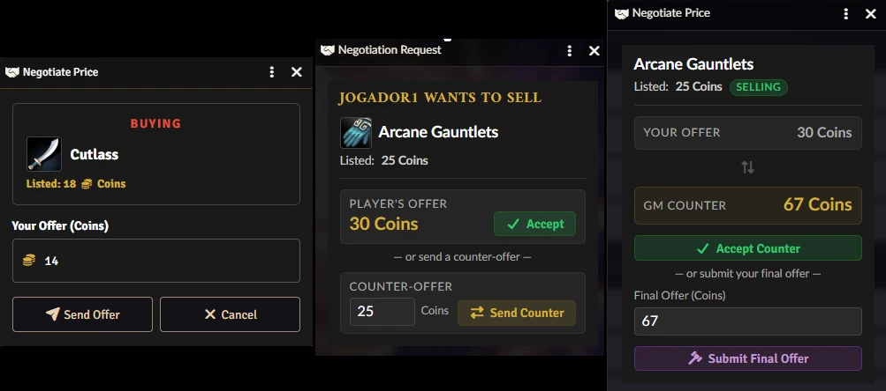
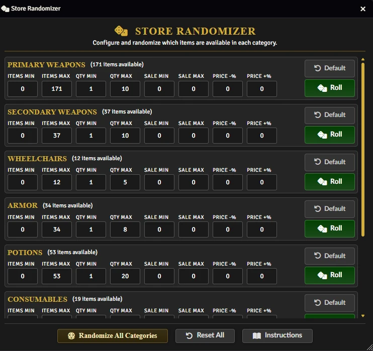
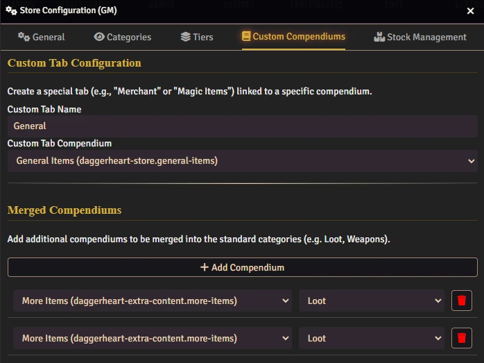

# 📖 Daggerheart: Store full guide

This is the detailed setup and configuration guide for GMs and players. For a quick overview of what the module does, see the [README](../README.md).

## Linking player characters

To buy and sell in the store, each user must have a linked Actor of type *character* assigned to them in Foundry VTT.

1. Right-click the player's name in the **Player List** (bottom left corner of the screen).
2. Select **User Configuration**.
3. In the configuration window, find the **Player Character** field.
4. Select the Actor that the user owns from the dropdown menu.

Make sure the user has Owner permission on that Actor before linking it.



If the setup is done correctly, the **Player List** shows the user name followed by the character name in brackets, for example *Player2 [Elara]*.



If a player opens the store without a linked Actor, a red alert says they cannot make purchases, and a chat message tells the GM. If you see the alert below, repeat the steps above.



## Opening the store

The GM can click **Open Store** in the Daggerheart menu, in the sidebar. The system shows that menu only to the GM.



Anyone, GM or player, can open the store with a script macro containing:

```js
Store.Open()
```

The GM can create this macro and give it to the players so they can open the store on their own.

With the store open, the GM has two header buttons to open it on other screens. **Show to Everyone** opens it for every connected player, and **Show to Player** opens it for one player you pick.

## Configuration (GM)

Click **Config**, the button with the gear icon at the top of the store window, to open the Store Config. It has these tabs:

- In **General** you set the **Party Actor** used for shared funds, the look of Epic items, and the price controls: **Global Price Multiplier** (50% to 300%), **Sale Discount** for items marked as on sale, and **Sell Ratio**, the share of the price players receive when they sell (for example 50%).
- **Categories** shows or hides whole categories. The categories are Primary Weapons, Secondary Weapons, Wheelchairs, Armor, Potions, Consumables and Loot.
- **Tiers** chooses which Tiers appear in each category, for example only Tier 1 in a small village shop.
- **Custom Compendiums** adds your own compendiums to the store. See Homebrew and custom content below.
- **Vendor** sets the merchant and the price changes tied to each character. See below.
- **Stock Management** turns on negotiation and limited stock. See below.



## Profiles

A profile keeps a whole store setup (prices, hidden items, active tiers and the rest) under a name, such as "Expensive City" or "Goblin Merchant". Pick a profile in the dropdown at the top of the store and use the buttons next to it.

- **Save Preset** saves the current setup as a new profile, or updates and renames the current one.
- **Load Preset** applies the selected profile to the store.
- **Delete Selected Profile** removes a profile you no longer need.



To move profiles to another world, use **Import / Export** in the module settings. The export saves the configuration and every profile in one file. When importing, you choose to replace the current settings, merge them, or bring in a single profile.

## Vendor and relationships

The **Vendor** tab of the Store Config sets who is behind the counter.

- **Store Name** is the title of the store window.
- **Vendor Name**, **Vendor Description** and **Vendor Image** are optional. They show the merchant's name, a short text and a square portrait in the store header.
- In **Character Relationships**, each player character gets a status: Hostile, Distrustful, Neutral, Friendly or Allied. The players see it in a tooltip on the merchant.
- **Relationship Modifiers** sets how much each status raises or lowers prices. Hostile and Distrustful make prices higher, Friendly and Allied make them lower, and Neutral changes nothing.
- **Enable Presence Modifier** gives a discount based on each character's Presence trait. With 1.5 in **% per Presence point**, a character with Presence +3 gets 4.5% off.

These modifiers are applied after all the other price rules.

## Stock and negotiation

Both options are in the **Stock Management** tab and need a Party Actor set in the General tab.

**Enable Limited Stock System** gives each item a quantity. Buying takes one unit from the stock, selling puts one back, and an item at zero cannot be bought. Stock is kept per profile, so several profiles can share the same Party Actor without mixing quantities. In **Quick Stock Configuration**, set a default quantity for each category and tier, then click **Apply Defaults** to set every item from that table. **Restock All** puts every item back to its default quantity.



**Enable Price Negotiations** adds a handshake button, **Negotiate Price**, to the items players can buy and sell, including unpriced items in their inventory. A negotiation goes like this:

1. The player clicks the handshake button and sends an offer.
2. A window opens for the GM, who accepts the offer or sends a counter-offer.
3. The player accepts the counter-offer or sends a final offer.
4. The GM accepts or rejects the final offer.

When an offer is accepted, the purchase or sale happens on its own at the agreed price. Only one negotiation can run at a time, and a purchase is not completed if the player can no longer pay for it.



## Randomizer

Click **Store Randomizer**, the dice button at the top of the store, to fill each category with a random selection. Each category has its own row:

- **Items Min** and **Items Max**: how many items stay visible. A button next to the maximum sets it to every item available.
- **Qty Min** and **Qty Max**: the stock quantity given to each visible item. 0 in **Qty Max** turns it off.
- **Sale Min** and **Sale Max**: how many of the visible items are put on sale.
- **Price -%** and **Price +%**: how far each price can go down or up.

**Roll** randomizes one category, and **Randomize All Categories** does them all after a confirmation. **Reset All** clears the hidden items, sales and price overrides, so every item shows at its default price. **Default** puts a row's numbers back to their defaults, and **Instructions** explains each field.

Items with their lock closed in the store are never changed by the Randomizer. Lock them one by one, or use **Lock All Items** in the search bar.



## Homebrew and custom content

Both options below are in the **Custom Compendiums** tab of the Store Config.

### Custom shop tab

You can create a tab with your own name and content, for a special merchant or a category of your own.

1. Create an **Item Compendium** in your world and add the items you want to sell.
2. Open the Store Config and go to the **Custom Compendiums** tab.
3. In **Custom Tab Configuration**, give the tab a name in **Custom Tab Name**, click **Add Compendium** and select the compendium you created.

The items now appear in your new tab in the store.

### Adding items to the default tabs

You can add your own items to the standard tabs (such as Primary Weapons or Armor) without replacing the system's items.

1. Create an **Item Compendium** and add your items.
2. Open the Store Config and go to the **Custom Compendiums** tab.
3. In **Merged Compendiums**, click **Add Compendium**.
4. In the new row, select the compendium in the first dropdown and the tab where its items should appear in the second.

To sell only your own items, turn off **Use Default Compendiums** in the same tab.


